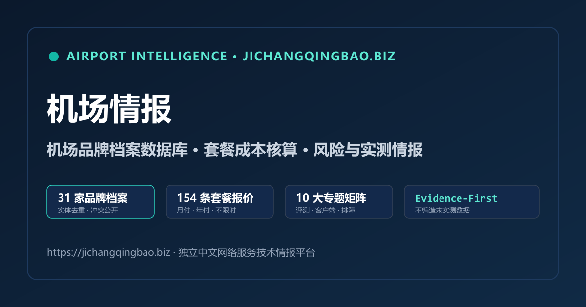
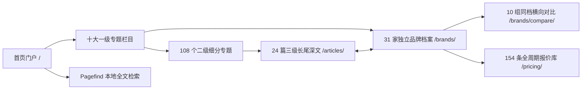

<div align="center">

# 机场情报 · Airport Intelligence

**独立中文网络服务技术情报平台 · 品牌档案数据库 · 套餐成本核算与风险实证系统**

[](https://astro.build)
[](https://tailwindcss.com)
[](https://pagefind.app)
[](#全站规模与结构概览)
[](#开发构建与自动化质检)

🌐 线上主域：`https://jichangqingbao.biz/` · 🔍 纯静态 SSG · 📊 Dark Network Observatory

<br />



</div>

---

## 核心定位与编辑原则

**机场情报（`jichangqingbao.biz`）** 不是传统推广导航页或主观排行榜，而是面向中文互联网用户的网络服务情报与决策基础设施。全站遵循 **Light Intelligence Editorial + Dark Network Observatory** 设计语言，以实证数据为核心底座：

- **五级证据透明分级**：严格区隔 `独立实测 (measured)`、`品牌方提供 (vendor)`、`历史测试资料 (historical)`、`待核实 (unverified)` 与 `来源冲突 (conflicted)`。
- **反灌水与反伪造约束**：不编造 `AggregateRating` 虚假星级，不把年付折算均价冒充单月门槛，不隐藏特殊套餐“不退换 / 优惠码排除”限制。
- **跨来源冲突公开（`CF-001` – `CF-018`）**：保留所有原始口径差异（如品牌合并去重、流媒体分区限制、链接格式疑点），在品牌档案页与审计日志页完整披露。
- **商业披露与内容隔离**：严格区分科普排障与商业转化页面；所有推广注册外链统一由结构化台账管理并附加 `rel="nofollow sponsored noopener"`。

---

## 全站规模与结构概览



| 站内核心模块 | 收录规模 | 说明与能力亮点 |
| :--- | :---: | :--- |
| **一级主专题栏目** | **10** | 覆盖推荐、价格、品牌、VPN、客户端、AI/流媒体、线路、教程、排障、风险与替代 |
| **二级细分专题页** | **108** | 均配备 Answer-First 直答框、结构化对照表、原生 `<details>` FAQ 与动态专题内链 |
| **三级长尾深度文章** | **24 篇** | 精准匹配排障报错、套餐数学核算、OpenWrt/iOS 实操与防钓鱼辨析（100% 含 `<table>` 与 `FAQPage`） |
| **独立品牌深度评测** | **31 / 31** | 完成实体去重与全库 Markdown 长评覆盖，整合 4 组 Dark Observatory 可观测图表与优惠码一键复制 |
| **全周期套餐报价库** | **154 条** | 支持按计费周期、预算上限、最低流量、订阅模式过滤，并按单 GB 成本与折算月价即时排序 |
| **双品牌横向对比页** | **10 组** | 同口径 10 项参数表 + 价流/线路分析 + 人群分流 + 冲突披露 + `FAQPage` Schema |
| **静态输出与全文索引** | **195 页** | Astro Static 全静态 HTML + `sitemap-index.xml`（193 条可索引 URL）+ `llms.txt` + `rss.xml` + Pagefind |

---

## 项目目录结构

```text
jichangqingbao.biz/
├── public/
│   ├── .htaccess                  # Apache 生产路由规范（HTTPS/非www/重复斜杠301、/sitemap.xml 映射、缓存与安全头）
│   ├── robots.txt                 # 放行主流及国内搜索引擎爬虫，声明 Sitemap
│   └── og-default.png             # 1200×630 默认 Open Graph 社交预览卡片
├── src/
│   ├── assets/                    # 品牌头像、品牌 Logo 与原始只读测速截图证据包
│   ├── components/
│   │   ├── brands/                # BrandCard、BrandDatabaseExplorer、AffiliateCta（含优惠码一键复制）
│   │   ├── charts/                # 四组 Dark Network Observatory 技术性能面板
│   │   ├── intelligence/          # TimelineList 风险与价格变更时间线
│   │   ├── navigation/            # Header（10 栏桌面下拉/移动抽屉）、Footer、Breadcrumbs（含 BreadcrumbList Schema）
│   │   └── seo/                   # SEOHead、GeoAnswerBox、AnchorToc、FaqSection、TopicPageTemplate
│   ├── content/
│   │   ├── articles/              # 24 篇三级长尾指南与排障 Markdown 集合
│   │   └── reviews/               # 31 家品牌独立深度评测 Markdown 集合
│   ├── data/
│   │   ├── keywords/              # 长尾词主表、文章映射表、集群关系与优先级台账
│   │   ├── pillars/               # 十大一级专题深度内容数据
│   │   ├── secondary/             # 二级专题动态丰富化与合并工具
│   │   ├── brands.json            # 31 家独立实体核心数据库
│   │   ├── plans.json             # 154 条套餐及单 GB 成本衍生表
│   │   ├── affiliate-links.json   # 推广外链、优惠码与适用限制唯一注册表
│   │   ├── data-conflicts.json    # CF-001 至 CF-018 跨来源冲突台账
│   │   └── ...                    # 客户端百科、测速结果、情报事件与来源清单
│   ├── layouts/BaseLayout.astro   # 全站公共布局（zh-CN、Pagefind 正文锚点、无障碍跳链）
│   └── pages/                     # 静态页面与端点（含 /llms.txt.ts、/rss.xml.ts、/articles/*、/brands/*）
├── scripts/
│   ├── compile-data.mjs           # 数据衍生汇总编译脚本
│   ├── audit-data.mjs             # 实体去重、价格计算与字段冲突自检
│   ├── audit-seo.mjs              # 全站 HTML Title/Desc/H1/Canonical/OG/内链/外链属性 QA
│   ├── audit-content.mjs          # 31 品牌深评、三级文章零孤立页、关键词零冲突与对比页质量检查
│   └── import-keywords.mjs        # GSC / Bing 导出关键词增量接入工具
└── reports/                       # 全站 SEO/GEO 审计、品牌矩阵与交付验收报告
```

---

## 开发构建与自动化质检

项目使用 `npm` 管理依赖与脚本：

```bash
# 1. 安装依赖
npm install

# 2. 启动本地开发预览服务器
npm run dev

# 3. 执行数据、类型、构建与全量 QA 流水线
npm run audit:data    # 校验 31 家品牌与冲突台账一致性
npm run check         # Astro & TypeScript 全站静态类型检查
npm run build         # 生成 dist/ 静态站、Sitemap 与 Pagefind 中文全文索引
npm run audit:seo     # 扫描 dist/ 全量 HTML、og:image、llms.txt 及推广外链 rel 属性
npm run audit:content # 校验 31 篇品牌档案、24 篇长尾文章零孤立及 10 组对比页完整度

# 4. 本地预览最终构建产物
npm run preview
```

---

## 上线配置与 Apache 部署说明

### 1. 站长平台构建期验证码注入（零客户端 JS）

[SEOHead.astro](src/components/seo/SEOHead.astro) 通过 [src/lib/data.ts](src/lib/data.ts) 中的 `SITE_VERIFICATION` 支持构建期直接生成静态 `<meta>` 标签。部署前按需设置环境变量后重新执行 `npm run build` 即可（未配置时不输出空白占位符）：

```bash
PUBLIC_GOOGLE_VERIFICATION=你的Google验证码
PUBLIC_BING_VERIFICATION=你的Bing_msvalidate01验证码
PUBLIC_SHENMA_VERIFICATION=你的神马验证码
PUBLIC_BAIDU_VERIFICATION=你的百度验证码
```

### 2. Apache 静态宿主部署

1. 执行 `npm run build` 生成完整的 `dist/` 目录（内含 `index.html`、`/pagefind/`、`/sitemap-index.xml`、`/sitemap-0.xml`、`/llms.txt`、`/rss.xml`、`/robots.txt`、`404.html` 与 `.htaccess`）。
2. 将 `dist/` 全部内容上传至 Apache `DocumentRoot`。
3. 确认已开启 `mod_rewrite`、`mod_headers`、`mod_expires`、`mod_deflate`（及可选 `mod_brotli`）与 `AllowOverride All`，确保 HTTPS/非 `www` 规范化 301、重复斜杠折叠及 `/sitemap.xml` → `/sitemap-index.xml` 直出生效。
4. 生产部署完毕后，在 **Google Search Console**、**Bing Webmaster Tools**、**神马站长平台** 与 **百度搜索资源平台** 认领主域并提交 `https://jichangqingbao.biz/sitemap-index.xml`。

---

## 数据维护规范

- **更新品牌与价格**：修订 `src/data/brands.json`（同步更新 `verifiedAt` / `updatedAt`）后执行 `node scripts/compile-data.mjs && npm run audit:data`。
- **更新合作链接与优惠码**：统一维护在 `src/data/affiliate-links.json`，禁止在正文硬编码原始跳转链接。
- **新增三级长尾文章**：在 `src/content/articles/` 添加符合 `content.config.ts` Schema 的 `.md` 文件，对应 `parentTopic` 二级专题枢纽与 `/articles/` 索引将自动挂载并进入 Sitemap、`rss.xml` 与 `llms.txt`。
